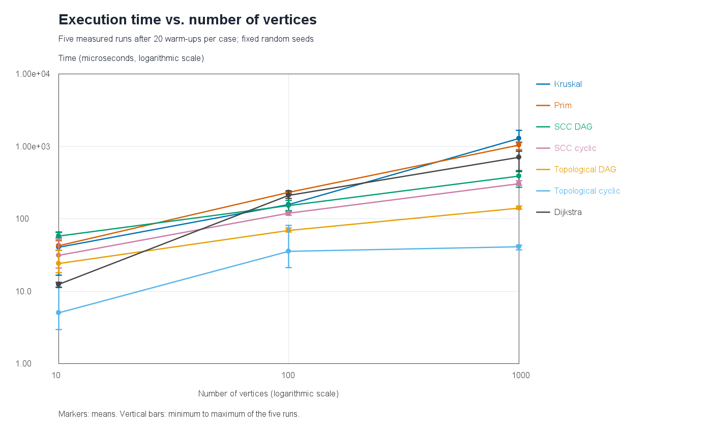
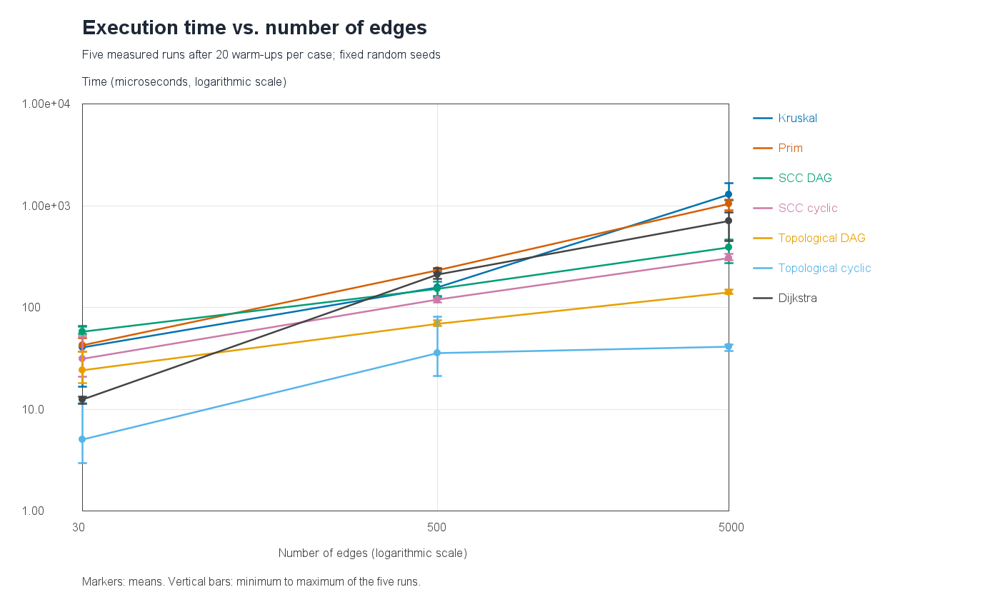

# Assignment 3 - Smart City Infrastructure and Route Planning

## Overview

This Java application represents city districts as vertices and roads or infrastructure connections as weighted edges. It supports minimum-cost infrastructure planning, directed connectivity analysis, service dependency ordering, and shortest-route planning. Districts use integer identifiers from 0 to V - 1.

An undirected graph models construction connections. A directed graph models one-way roads or service dependencies. An edge weight represents either a construction cost or a travel distance in a given scenario; these meanings are not mixed within an experiment.

The graph uses adjacency lists and also stores one logical edge list. An undirected road occurs once in the edge list and twice in the adjacency lists. The representation occupies O(V + E) space. Graphs may have isolated vertices, repeated weights, parallel edges, and self-loops; the experiment generator creates simple graphs without parallel edges or self-loops.

### Project structure

```text
src/
  Main.java                         Small city demonstration
  graph/Graph.java                  Adjacency-list graph and edge record
  graph/Metrics.java                Operation counters
  graph/GraphGenerator.java         Fixed-seed graph generation
  dsu/DisjointSetUnion.java         Path compression and union by rank
  mst/MinimumSpanningTree.java      Kruskal and Prim
  connectivity/Connectivity.java    Kahn topological sort and Kosaraju SCC
  shortestpath/Dijkstra.java        Distances and path reconstruction
  tests/GraphTests.java             Standalone correctness tests
  experiments/Experiments.java      Timing, CSV tables and PNG plots
results/
  tables/                           Raw runs, averages, counters and test report
  plots/                            The two required execution-time plots
README.md                           Complete report
```

### Build and run

Use a **JDK 17 or newer**. There are no external Java dependencies, build-tool downloads, or plotting packages. This project was compiled and run in IntelliJ IDEA with OpenJDK 25.0.1.

In IntelliJ IDEA:

1. Open the repository folder and select the installed JDK as the Project SDK.
2. If necessary, right-click `src` and choose **Mark Directory as > Sources Root**.
3. Run `Main.main()` to demonstrate all three tasks. The default source district is 0. To select another district, put a number from 0 to 5 in the Main run configuration's **Program arguments** field.
4. Run `tests.GraphTests.main()` for the correctness checks.
5. Run `experiments.Experiments.main()` to reproduce the experimental results. Set its **Working directory** to the repository root.

Alternatively, from the repository root with the JDK tools on PATH:

```text
javac -encoding UTF-8 -d build -sourcepath src src/Main.java src/tests/GraphTests.java src/experiments/Experiments.java
java -cp build Main
java -cp build Main 2
java -cp build tests.GraphTests
java -cp build experiments.Experiments
```

The experiments regenerate the CSV files, Markdown tables and PNG plots, and replace only the section between the README results markers. Graphs and operation counts are reproducible; elapsed times depend on the machine and JVM state.

## Implementation

**DSU.** Each vertex starts in its own set. `find` first follows parent pointers to a root, then makes every vertex on that path point directly to that root. `union` finds both roots, attaches the root with the smaller rank to the other root, and increases the rank only when two equal-rank trees merge. A union within one set returns false. A component counter decreases only after a successful merge.

**Kruskal.** Copy and sort the logical edges by weight, using endpoint identifiers to resolve ties deterministically. Accept an edge only if DSU merges two previously separate components. Stop after V - 1 selected edges, or exhaust the list if the graph is disconnected. Sum selected weights in a `long`.

**Prim.** Use Java's binary-heap `PriorityQueue` to store candidate edges crossing from visited to unvisited vertices. Remove the cheapest candidate and skip it if its destination has already been visited. This is the lazy version of Prim: obsolete heap entries are discarded when removed. Restart from each unvisited vertex to handle disconnected graphs. Both MST methods return selected edges, total weight, component count and connectivity. A disconnected input produces a minimum spanning forest, not a claim that a spanning tree exists.

**Topological ordering.** Kahn's algorithm counts indegrees, puts all zero-indegree vertices in an `ArrayDeque`, then removes them and reduces their neighbors' indegrees. If fewer than V vertices are processed, a directed cycle prevents a full ordering. In that case, the method reports failure and discards the partial ordering.

**SCC.** Kosaraju's algorithm performs a DFS to obtain finishing order, constructs the transposed directed graph, and performs a second DFS in reverse finishing order. Each second-pass DFS produces one SCC, including singleton components and isolated vertices. DFS uses recursion; its maximum depth is O(V).

**Dijkstra.** Store tentative distances in a `long[]` and predecessors in an `int[]`. A binary heap holds pairs of district and tentative distance. A successful relaxation adds a new pair; outdated pairs are skipped when removed. The source has distance 0 and path [source]. An unreachable district has distance `Long.MAX_VALUE` and an empty path. `pathTo` follows predecessors and reverses the result. Distances use `long` to avoid overflow when several large integer edge weights are added.

Dijkstra rejects a graph containing any negative edge weight. Its greedy correctness argument relies on the smallest extracted distance being final: with non-negative edges, a later route cannot make that distance smaller. For example, edges S->A (2), S->B (5), B->A (-10) make A's true distance -5 even though A would be extracted before B. A heap implementation that keeps reopening vertices may correct some such examples, but loses Dijkstra's guarantee and can fail to terminate on a reachable negative cycle. Bellman-Ford is an appropriate alternative when negative weights must be supported; it is outside this assignment's implementation scope.

## Complexity Analysis

V is the number of vertices, E counts logical edges, and alpha(V) is the inverse Ackermann function. The table gives auxiliary space in addition to the input graph. Result storage is included.

| Algorithm | Time | Auxiliary space | Assumptions |
|---|---|---|---|
| DSU initialization | O(V) | O(V) | Parent and rank arrays |
| DSU find | O(alpha(V)) amortized | O(1) per call | Iterative compression, with union by rank |
| DSU union | O(alpha(V)) amortized | O(1) per call | Two find calls and one root link |
| Kruskal | O(V + E log(E + 1) + E alpha(V)) | O(V + E) | Sorted edge copy, sorting workspace and DSU |
| Lazy Prim | O(V + E log(E + 1)) | O(V + E) | Adjacency lists; heap may contain O(E) candidates |
| Kosaraju SCC | O(V + E) | O(V + E) | Two DFS passes, transpose and recursive DFS stack |
| Kahn topological ordering | O(V + E) | O(V) | Indegrees, FIFO queue and output ordering |
| Lazy-heap Dijkstra | O(V + E log(E + 1)) | O(V + E) | Non-negative weights; at most O(E) successful relaxations |

DSU's bounds are amortized over a sequence of operations. A single find can still take O(log V) with union by rank. Without either optimization, an unfavorable sequence can create a chain and make a find take O(V). Rank limits tree height to O(log V), while compression flattens the paths used by subsequent calls. The targeted DSU test confirms that repeating a find after compression requires fewer parent traversals.

More vertices increase array initialization, vertex iteration, output storage and potential DFS depth. More edges increase sorting and heap work in MST algorithms and Dijkstra. Kruskal must sort all E edges even if it later stops accepting edges early. Prim and Dijkstra scan adjacency entries, which total 2E for a fully reachable undirected graph. SCC and topological ordering grow linearly with the vertices and edges actually processed.

For simple graphs E is at most O(V^2), so log(E + 1) is O(log V). Thus the lazy-heap bounds reduce to the familiar O((V + E) log V) form for the generated graphs. The more general log(E + 1) bounds and O(E) heap space also describe inputs with parallel edges; an indexed decrease-key heap would have different space bounds. Recovering one path takes O(V) in the worst case. Printing every full path can require O(V^2) output and is excluded from the shortest-path timings.

## Experimental Setup

| Configuration | Vertices (V) | Edges (E) |
|---|---:|---:|
| Small | 10 | 30 |
| Medium | 100 | 500 |
| Large | 1,000 | 5,000 |

### Graph generation

Generation uses `java.util.Random` with base seed **20261021**. For a configuration and graph type, the exact seed is `20261021 + 31 * V + E + type.ordinal()`. The type ordinals are UNDIRECTED=0, DAG=1, CYCLIC=2. The actual seed is also recorded in each CSV row. Accepted edge weights are uniformly chosen integers from 1 through 100.

- **Connected undirected graph:** for each v from 1 to V - 1, connect v to one randomly selected earlier vertex. This creates a spanning tree. Add random unused unordered vertex pairs until there are exactly E logical edges. Kruskal, Prim and Dijkstra use the same graph object; Dijkstra's source is 0.
- **Directed DAG:** first add the chain 0->1->...->V-1. Add unused directed edges only from smaller to larger identifiers, so no cycle can form. All vertices are reachable from 0, and every SCC is a singleton.
- **Directed cyclic graph:** add the same chain and the edge V-1->0, then add random unused ordered pairs. The ring guarantees a cycle and makes the whole graph strongly connected. Consequently, there is exactly one SCC and no topological order. The separate correctness tests also cover graphs with several SCCs and cycles mixed with acyclic portions.

A set rejects duplicate endpoint pairs, and self-loops are excluded during generation. These constructions guarantee the required properties; they do not sample all graphs uniformly. Each algorithm reuses the same fixed generated graph for its five repetitions, with fresh algorithm state and counters on every run. Input graphs are not changed by the algorithms.

### Measurement procedure

There are seven cases per size: Kruskal, Prim, SCC on a DAG, SCC on a cyclic graph, topological ordering on a DAG, topological ordering on a cyclic graph, and Dijkstra. This gives **21 cases and 105 measured runs**.

Each case receives 20 untimed warm-up runs, followed by exactly five individually timed runs. `System.nanoTime()` is read immediately before and after the algorithm dispatch. The arithmetic mean is the sum of the five elapsed nanosecond values divided by five. The result tables display microseconds, with minimum and maximum to show variability. No runs are discarded.

Timed work includes algorithm data allocation, sorting or transpose construction where applicable, operation counting, and a small dispatch/result wrapper. Graph generation, warm-up, result validation, CSV formatting, file writing, plotting, console output and path printing are outside each measured interval. Results are consumed after timing. Each measured result and its counters are checked against the untimed result. Kruskal and Prim are also checked for equal weight and connectivity before measurement.

The CSV files preserve all measured runs and exact counters. The recorded environment includes Java, JVM, operating system, CPU, available processors and UTC timestamp. These are short educational microbenchmarks: five repetitions and a small warm-up do not eliminate JIT compilation, garbage collection, CPU scheduling or background load. Small timing differences and non-monotonic changes should therefore not be treated as universal rankings.

### Meaning of the counters

| Counter | Counted event |
|---|---|
| Edges examined | One processed logical edge or adjacency entry, depending on the algorithm |
| Comparator calls | One sort/heap comparator invocation, including its tie-breaking logic; not every primitive comparison |
| Find calls / union calls | Public DSU calls; each Kruskal union invokes find twice |
| Parent traversals | One parent link followed in either pass of find, including the compression pass |
| Queue adds / removes | One insertion/removal; stale heap entries are included |
| Relaxations | A successful distance decrease in Dijkstra |
| Vertex visits | Prim visits, successful Dijkstra extractions, Kahn removals, or both Kosaraju DFS passes |

Kruskal's edge counter excludes sorting, which has its separate comparator counter. Prim scans each undirected adjacency entry once. Kosaraju counts E entries in the first DFS, E when creating the transpose and E in the second DFS, giving **3E examinations and 2V visits**. Kahn counts indegree construction plus edges leaving processed vertices: **2E on a DAG**, and **E on the generated ring-containing inputs**, where no vertex initially has indegree zero. Counters describe different kinds of work and should not be added into a single universal operation total.

## Results

The following tables are generated from the measured runs. Raw data are in [raw-runs.csv](results/tables/raw-runs.csv), averaged results and all counters in [summary.csv](results/tables/summary.csv), and the recorded machine details in [environment.txt](results/tables/environment.txt).

<!-- RESULTS START -->

### Recorded environment

- UTC run time: 2026-10-21T12:53:56.562565Z
- Java: 25.0.1+8-27 / OpenJDK 64-Bit Server VM
- OS: Windows 11 10.0 / amd64
- CPU: Intel64 Family 6 Model 154 Stepping 3, GenuineIntel
- Available processors: 12
- Base seed: 20261021
- Warm-ups per case: 20
- Measured repetitions per case: 5

### Execution time

Average, minimum and maximum refer to the five measured runs. Unit: microseconds.

| Algorithm | V | E | Average | Minimum | Maximum |
|---|---:|---:|---:|---:|---:|
| Kruskal | 10 | 30 | 40.620 | 16.700 | 66.700 |
| Prim | 10 | 30 | 42.640 | 36.800 | 50.400 |
| SCC DAG | 10 | 30 | 58.440 | 55.600 | 64.900 |
| SCC cyclic | 10 | 30 | 31.280 | 20.900 | 52.400 |
| Topological DAG | 10 | 30 | 24.220 | 18.300 | 36.800 |
| Topological cyclic | 10 | 30 | 5.040 | 3.000 | 11.600 |
| Dijkstra | 10 | 30 | 12.520 | 11.300 | 13.400 |
| Kruskal | 100 | 500 | 158.480 | 126.600 | 222.900 |
| Prim | 100 | 500 | 233.040 | 229.800 | 238.400 |
| SCC DAG | 100 | 500 | 153.280 | 131.400 | 180.200 |
| SCC cyclic | 100 | 500 | 120.420 | 113.000 | 124.900 |
| Topological DAG | 100 | 500 | 69.720 | 66.400 | 75.600 |
| Topological cyclic | 100 | 500 | 35.900 | 21.200 | 81.300 |
| Dijkstra | 100 | 500 | 213.320 | 192.400 | 244.300 |
| Kruskal | 1000 | 5000 | 1293.900 | 1145.300 | 1686.700 |
| Prim | 1000 | 5000 | 1048.740 | 904.000 | 1162.600 |
| SCC DAG | 1000 | 5000 | 390.600 | 274.000 | 471.000 |
| SCC cyclic | 1000 | 5000 | 308.600 | 293.300 | 338.500 |
| Topological DAG | 1000 | 5000 | 142.500 | 136.900 | 149.900 |
| Topological cyclic | 1000 | 5000 | 41.600 | 37.600 | 43.500 |
| Dijkstra | 1000 | 5000 | 708.540 | 453.200 | 866.300 |

### Edge and queue operations

Counters are identical in all five repeats; the per-run values below therefore also equal their averages.

| Algorithm | V | Edges examined | Comparator calls | Queue adds | Queue removes | Relaxations | Vertex visits |
|---|---:|---:|---:|---:|---:|---:|---:|
| Kruskal | 10 | 10 | 104 | 0 | 0 | 0 | 0 |
| Prim | 10 | 60 | 198 | 30 | 30 | 0 | 10 |
| SCC DAG | 10 | 90 | 0 | 0 | 0 | 0 | 20 |
| SCC cyclic | 10 | 90 | 0 | 0 | 0 | 0 | 20 |
| Topological DAG | 10 | 60 | 0 | 10 | 10 | 0 | 10 |
| Topological cyclic | 10 | 30 | 0 | 0 | 0 | 0 | 0 |
| Dijkstra | 10 | 60 | 109 | 21 | 21 | 20 | 10 |
| Kruskal | 100 | 249 | 3836 | 0 | 0 | 0 | 0 |
| Prim | 100 | 1000 | 7610 | 500 | 500 | 0 | 100 |
| SCC DAG | 100 | 1500 | 0 | 0 | 0 | 0 | 200 |
| SCC cyclic | 100 | 1500 | 0 | 0 | 0 | 0 | 200 |
| Topological DAG | 100 | 1000 | 0 | 100 | 100 | 0 | 100 |
| Topological cyclic | 100 | 500 | 0 | 0 | 0 | 0 | 0 |
| Dijkstra | 100 | 1000 | 2154 | 186 | 186 | 185 | 100 |
| Kruskal | 1000 | 3410 | 55129 | 0 | 0 | 0 | 0 |
| Prim | 1000 | 10000 | 111737 | 5000 | 5000 | 0 | 1000 |
| SCC DAG | 1000 | 15000 | 0 | 0 | 0 | 0 | 2000 |
| SCC cyclic | 1000 | 15000 | 0 | 0 | 0 | 0 | 2000 |
| Topological DAG | 1000 | 10000 | 0 | 1000 | 1000 | 0 | 1000 |
| Topological cyclic | 1000 | 5000 | 0 | 0 | 0 | 0 | 0 |
| Dijkstra | 1000 | 10000 | 35812 | 1941 | 1941 | 1940 | 1000 |

### MST agreement and DSU operations

| Algorithm | V | Forest/MST weight | Find calls | Union calls | Parent traversals |
|---|---:|---:|---:|---:|---:|
| Kruskal | 10 | 102 | 20 | 10 | 18 |
| Prim | 10 | 102 | 0 | 0 | 0 |
| Kruskal | 100 | 1314 | 498 | 249 | 844 |
| Prim | 100 | 1314 | 0 | 0 | 0 |
| Kruskal | 1000 | 12330 | 6820 | 3410 | 12492 |
| Prim | 1000 | 12330 | 0 | 0 | 0 |

Prim does not use a DSU, so its DSU counters are zero.

<!-- RESULTS END -->

### Execution time vs. vertices



### Execution time vs. edges



Both axes use logarithmic scales so that all three configurations and seven series remain visible. Points are the measured means; vertical bars span the minimum to maximum of the five runs. V and E increase together in the required configurations, so these two plots show the same experiments with different horizontal axes. They do not independently isolate the effect of changing only V or only E.

## Comparison and Discussion

In the recorded run, Kruskal took 24.400 us and Prim 33.820 us on the small graph. The order reversed at V=100 (273.040 us vs. 216.680 us) and V=1,000 (2,020.300 us vs. 1,565.360 us). Prim was about 1.29 times faster on the large input, but this is a result for these graphs and this run, not a universal ranking. The operation table explains the different sorting, DSU and heap workloads.

SCC on DAGs increased from 42.560 to 244.580 to 426.820 us; on cyclic graphs it increased from 47.760 to 184.420 to 379.020 us. Dijkstra increased from 12.520 to 246.480 to 480.780 us. All three trends show more work on larger inputs, but the timing ratios are much smaller than the edge-count ratios, consistent with changing JVM overhead and optimization effects. The deterministic operation counts give a clearer match to the theoretical bounds.

Topological ordering on DAGs took 34.940, 110.160 and 202.580 us. Detecting the generated cyclic graphs took 6.640, 48.960 and 43.640 us. The large cyclic case was slightly faster than the medium case despite examining more edges; this non-monotonic timing illustrates the limits of a five-run microbenchmark. The empty initial queue explains why the cyclic cases perform less work than the DAG cases.

**Kruskal vs. Prim.** Both return the same minimum total weight for every connected experiment. Equal edge weights may allow different valid trees, so equality of total weight and a valid spanning structure matter more than identical edge lists. Kruskal pays for one global edge sort and then uses inexpensive amortized DSU operations. Prim avoids a global sort but maintains a heap throughout its traversal and removes obsolete candidate edges. Its 2E adjacency examinations and heap comparisons explain why a smaller logical edge count in Kruskal is not, by itself, a complete time comparison. Both implementations have comparable asymptotic bounds on these sparse simple graphs; their measured difference depends on constants and graph structure.

**DSU.** Kruskal's find count is twice its union count. Failed unions prevent cycles without changing the component count. The parent traversal count records the actual pointer work, including compression, and the dedicated test shows the reduction for a repeated find. Rank keeps merges balanced, while compression improves later queries. These optimizations explain why DSU is not expected to dominate the edge sort for large inputs. A separate unoptimized DSU benchmark is not needed to interpret the recorded implementation; the improvement claim follows from the tree-height and amortized analysis, with the compression effect checked directly.

**SCC growth.** As E increases from 30 to 500 to 5,000, Kosaraju's examinations are exactly 90, 1,500 and 15,000. Its visits are 20, 200 and 2,000. These deterministic counts agree with O(V + E), even if elapsed times grow irregularly. The DAG creates V singleton result lists, while the cyclic graph creates one large list. Allocation patterns, DFS depth and JVM state can therefore give different times despite equal edge and visit counts.

**Topological ordering.** The DAG cases process all V vertices and examine 2E edges. The cyclic cases still construct indegrees and scan the vertex array, but the ring leaves the initial queue empty. They examine E edges and process no vertices. A lower time for these cyclic cases represents an earlier failure path, not a more efficient way to order a cyclic graph. The worst-case bound remains O(V + E).

**Dijkstra.** The source reaches all vertices in each connected undirected experiment, so the edge examinations are 60, 1,000 and 10,000, and the useful vertex visits are 10, 100 and 1,000. Queue insertions and successful relaxations depend on weights and alternative routes; obsolete entries increase queue removals and heap comparisons. The observed counts therefore include both a linear adjacency scan and the extra heap work predicted by the complexity bound. Unreachable vertices are demonstrated and tested separately rather than introduced into the connected MST input.

The plots and operation tables support the predicted growth of work, but three paired sizes and one generated graph per type/size cannot establish a precise asymptotic curve or a universal fastest algorithm. Operation counts provide a more stable explanation than sub-millisecond timing differences alone.

## Testing

The standalone tests completed successfully in IntelliJ: **13 test groups and 33,018 correctness checks**. Checks throw `AssertionError` directly, so they do not depend on the JVM `-ea` option. The saved output is [tests.txt](results/tables/tests.txt).

| Test group | Correctness checks |
|---|---|
| DSU | Successful and repeated unions, component count, roots, and fewer traversals after compression |
| Small weighted graph | Known MST weight 19 for both algorithms; selected edge count and spanning connectivity |
| Disconnected graphs | Minimum spanning forest weight, correct component count, isolated vertices and graph with no edges |
| Multiple MSTs / duplicate weights | Equal-weight square, parallel equal-weight edges and correct minimum weight; negative MST weights also checked |
| Single vertex | Weight 0, connected singleton MST, one SCC, valid order, distance 0 and path [0] |
| Shortest paths | Known distances and routes, zero-weight edge, stale heap entry, changed source and unreachable vertex |
| Large weights / invalid inputs | Distance 4,000,000,000, negative-weight rejection, invalid vertices, and directed/undirected preconditions |
| Cycles | Directed cycle, self-loop, and rejecting a partial topological ordering |
| Known SCCs | Five SCCs with both cycles and isolated vertices |
| DAGs | All 1,024 subsets of the ten forward edges under a fixed permutation of five vertex labels; every returned order is a full permutation respecting every edge |
| Independent shortest-path / SCC oracle | Forty fixed-seed directed graphs with eight vertices; Floyd-Warshall checks all sources and targets, reconstructed path weights and mutual reachability |
| Independent MST oracle | Twenty small connected graphs; exhaustive enumeration of candidate spanning trees checks the optimal weight without using either MST algorithm as the oracle |
| Generator | Exact required V/E, repeated-seed edge/weight equality, MST agreement, DAG validity and guaranteed cycles at all three sizes |

SCC checks verify both that every vertex appears exactly once and that two vertices share a component if and only if they are mutually reachable. MST tests verify weight, V minus component-count edges, and preservation of connectivity. Dijkstra checks verify every distance, path endpoint, actual path edge and total path weight. These tests evaluate algorithmic results rather than a particular tie-breaking order.

## Conclusion

Kruskal and Prim solve the minimum-cost undirected infrastructure problem and agree on total cost. Kruskal is convenient when an edge list is already available; Prim fits adjacency-based expansion from visited districts. DSU makes Kruskal's repeated connectivity checks efficient through balanced merging and path compression.

Kosaraju identifies mutually reachable groups in directed road networks, while topological ordering schedules services only when their dependencies form a DAG. Dijkstra finds distances and recoverable routes from a selected district with non-negative travel weights and explicitly reports unreachable locations. An MST minimizes total construction cost and does not replace a shortest-path algorithm for travel planning.

The fixed-seed experiments, saved raw runs, operation counters, tests and regenerated plots connect the theoretical analysis to measured behavior. The implementation keeps these tasks separate and uses standard Java collections without external dependencies.
